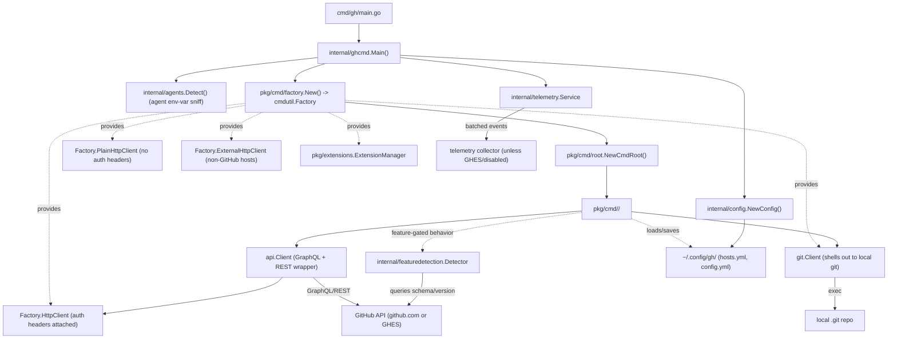

`AGENTS.md`'s "Architecture" section already gives the entrypoint one-liner (`cmd/gh/main.go` → `internal/ghcmd.Main()` → `pkg/cmd/root.NewCmdRoot()`) and the key-packages list. This diagram fills in what's actually wired together at runtime and where each `pkg/cmd/<command>` talks to the outside world.

Non-obvious edges:
- `Factory.HttpClient`, `PlainHttpClient`, and `ExternalHttpClient` are three separate clients, not layers of one — see [[gotchas]] for when to use each.
- `internal/featuredetection` queries the target host's GraphQL schema/version to decide GHES-vs-github.com behavior at runtime; it's not a compile-time or config-time switch.
- Telemetry is force-disabled whenever the user looks like a GHES user (enterprise token env vars or an enterprise host in config) — see `mightBeGHESUser` in `internal/ghcmd/cmd.go`.
