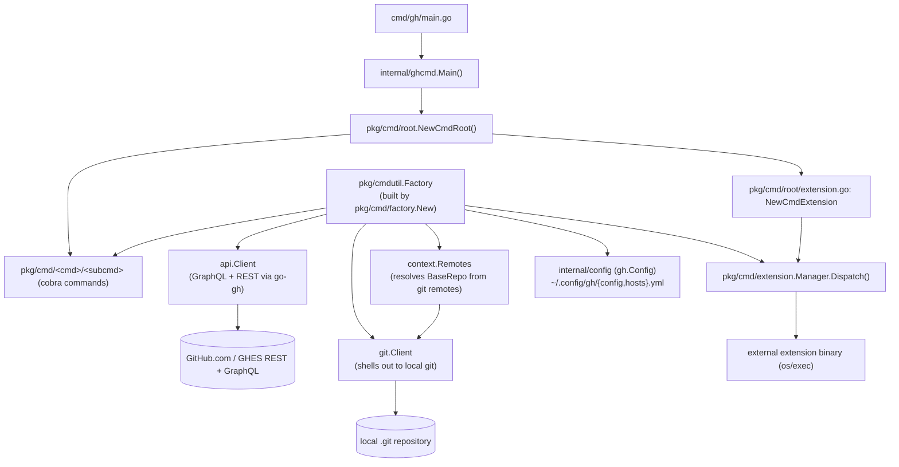

- `internal/ghcmd.Main()` is the thin, real entrypoint; `func main()` in `cmd/gh/main.go` just calls it and
  sets the process exit code (also exercised directly as the `gh` binary inside acceptance tests via
  `testscript.RunMain`, see `acceptance/acceptance_test.go`).
- `pkg/cmd/factory.New()` builds every dependency a command needs (`api`, `git`, config, prompter, browser,
  extension manager) as lazily-invoked closures on `cmdutil.Factory` — commands call e.g. `f.HttpClient()`
  inside `RunE`, never at construction time (see `pkg/cmd/factory/default.go:26-47`).
- Extensions are not `pkg/cmd/` packages. `pkg/cmd/root/extension.go` registers one cobra command per
  discovered extension and delegates actual execution to `extension.Manager.Dispatch`, which execs the
  extension's binary/git-checkout with the remaining args. See [[extensions]].
- `context.Remotes` / `BaseRepoFunc` resolve which repo a command targets from local git remotes filtered
  to authenticated hosts (`pkg/cmd/factory/default.go:49-82`); `docs/project-layout.md` calls `context/`
  itself deprecated but this resolution flow is still load-bearing for nearly every repo-scoped command.
