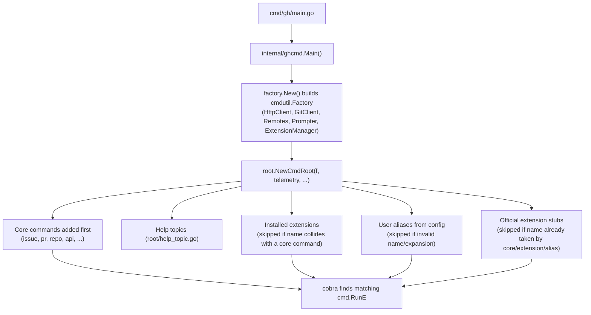

## Command name resolution precedence

Registration order in `NewCmdRoot` (`pkg/cmd/root/root.go`) is: core commands -> help topics -> installed extensions -> user aliases -> official extension stubs. Each later category explicitly does `cmd.Find([]string{name})` first and skips itself if a command of that name already exists. So a locally installed extension named e.g. `gh-issue` would never shadow the built-in `gh issue`, and a stub for an official extension never shows up if the user already has an alias or a real extension with that name.

## Two BaseRepo resolution strategies

`cmdutil.Factory.BaseRepo` is set twice, differently, in `root.go`:

- The plain `factory.BaseRepoFunc` (used for `NewCmdRoot`'s initial factory) just takes `Remotes()[0]` - no API calls.
- `factory.SmartBaseRepoFunc(f)` is substituted for a **copy** of the factory (`repoResolvingCmdFactory := *f`) used only by repo-context commands (`pr`, `issue`, `repo`, `release`, `run`, `workflow`, `label`, `cache`, `api`, `browse`, `discussion`, `org`, `ruleset`, `agent-task`). It hits the GraphQL API to resolve repo networks/parents and can prompt the user to run `gh repo set-default` when remotes are ambiguous.

Remotes themselves are ordered `upstream` > `github` > `origin` > others (see the extensive doc comment on `BaseRepoFunc` in `pkg/cmd/factory/default.go`), and only remotes for hosts the user is authenticated against are retained. If you add a new command that needs a base repo, wire it through `repoResolvingCmdFactory`, not the raw `f`, or you'll silently get the "first remote, no API" behavior instead of smart resolution.

## Telemetry recording

`cmdutil.RecordTelemetryForSubcommands` (called once, on the fully-assembled root command) walks the whole command tree and wraps every leaf `RunE` to emit a `command_invocation` event with sorted flag names, unless `cmdutil.DisableTelemetry`/`DisableTelemetryForSubcommands` set the `telemetry: disabled` annotation on that command first. `cmdutil.DisableAuthCheck` works the same way via a different annotation. When adding a new command that shouldn't be tracked or shouldn't require auth, set the annotation before `RecordTelemetryForSubcommands`/the auth-check runs, i.e. before `NewCmdRoot` returns.
