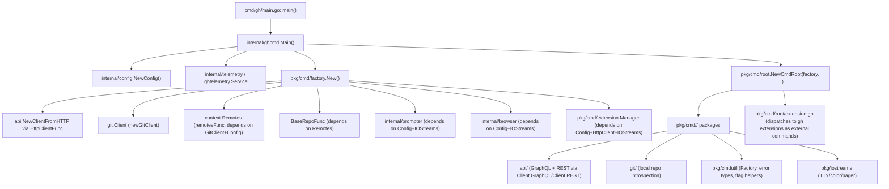

Notes on non-obvious edges:
- `factory.New()` wires dependencies in a strict order documented at `pkg/cmd/factory/default.go:38-44` - `GitClient` before `Remotes` before `BaseRepo` before `Prompter`/`Browser`/`ExtensionManager`/`Branch`. Each depends on the previous, so reordering breaks construction.
- `BaseRepoFunc` (`pkg/cmd/factory/default.go:74`) always picks remotes[0] from an already-sorted list (`upstream` > `github` > `origin` > others); it does not itself do the sorting, `remotesFunc` does.
- Extension commands are distinguished from built-in ones purely by `cobra.Command.GroupID == "extension"` (`internal/ghcmd/cmd.go:277-278`), which is how `gh help <ext>` gets rewritten to `<ext> --help`.
- Telemetry service selection in `Main()` branches on `cfg.Telemetry().Value` (Disabled/Logged/Enabled) and independently forces no-op if `mightBeGHESUser(cfg)` is true - GHES users never get real telemetry even if the config says enabled.
